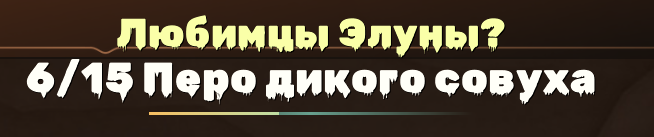

# Sintezza Notifications

Animated notifications and combat signals for WoW Forever 1.60.1 (interface 16001). Quest notifications show acceptance, objective progress, and turn-in for ordinary quests and world quests. Other notifications cover zones and subzones, achievements, boss emotes, rare deaths and scenarios. Scenario objective progress and level-ups are off by default.

Quest progress shows the objective count and fill at a glance.

## Installation

Extract the release ZIP so `Interface/AddOns/Sintezza_Notifications/Sintezza_Notifications.toc` is present. Enable Sintezza Notifications in the character selection screen. Install [Sintezza Theme](https://www.curseforge.com/wow/addons/sintezza-theme) to use the settings window.

Addon text defaults to Russian on `ruRU` and English on every other client locale. You can select either language in Sintezza Theme. Quest names, objectives, and locations use the text supplied by the game.

## Position and typography

Open the shared Sintezza Theme settings window using `/snotify`, the minimap button, or **Settings → AddOns → Sintezza Notifications → Open settings**. Drag the minimap button to place it, or hide it under **Window & minimap**.

The sidebar has three groups: **Notifications**, **Signals**, and **Settings**. Edit the controls on the left and see the preview on the right. Choose **Play in game** to see the alert at its configured position.

Open **Quests**, **Zones**, **Transport**, or **Other events** under **Notifications** to find that group's triggers, fonts, position, colors, opacity, and animation on one page. On any notification or signal page, choose **Move** and drag the alert itself. Choose **Done** to save or press Escape to cancel. The side-by-side **X** and **Y** sliders let you edit the offsets from the screen center directly. Positions are shared across characters.

The quest sample can show progress, objective completion, acceptance, or turn-in. It uses the current journal, prefers the super-tracked quest, and provides an example when the journal has no suitable quest. Objective completion and turn-in pulse the accent while quest animations are enabled. **Show rewards on turn-in** displays XP and money reported by the client. The zones sample uses your current location and offers a discovery example.

**Notifications → Quests** can hide WoW's yellow quest progress text while Sintezza handles quest notifications. The compact progress layout uses a smaller quest title above the objective counter. Both options are enabled by default and can be adjusted independently.

By default the title inherits the Sintezza Theme title font, and detail text inherits its interface font. Font choices include the active combat font and fonts registered by other addons with LibSharedMedia. Spectral Medium and Fira Sans Medium are the fallback for inherited fonts when Theme is absent.

Use the switch in **Trigger** to enable or disable that notification type. The Other events switch pauses the group and keeps each event's selection. Set background opacity to zero to hide the background, or turn off soft edges for a rectangular background. **Reset colors** resets the palette for the current page.

**Notifications → Transport** can display Shortest Path Forever’s onboard arrival warning as a countdown. The display duration follows the countdown. Keep **Alert before a boat arrives** enabled in Shortest Path Forever. An existing countdown setting and position are imported from the active Sintezza UI profile when available.

- `/snotify` opens the themed window when Sintezza Theme is loaded.
- `/snotify move` opens or closes placement.
- `/snotify test` plays the live-data preview.
- `/snotify status` reports signal ownership and the availability of the current mana reading.

## Combat and player signals

The separate **Signals** section contains **Combat**, **Stealth**, **Health**, **Mana**, and **Aggro**. Health, mana and dungeon or raid aggro alerts are opt-in. Choose a trigger threshold and a higher recovery threshold for health and mana. Mana can signal on the first observed decrease at or below the trigger threshold, even if it was already low when enabled. Another mana alert requires a readable recovery to the upper threshold followed by a new drop to the lower threshold. When the game masks mana, the alert resumes when readable values provide the required evidence. **Dungeons and raids only** can be enabled independently for health and mana.

With a compatible Sintezza UI loaded, Notifications takes ownership of combat, stealth, health and aggro. It imports the active UI alert settings on the first handoff and saves subsequent changes in its own profile. The **Alerts** entry in Sintezza UI opens Notifications, and Sintezza UI suspends its local alert renderer and listeners. After the player enters the world, Sintezza UI posts a single chat message listing alerts enabled in both profiles. When Notifications is disabled, Sintezza UI uses its saved fallback settings. Older Sintezza UI builds without the handoff API continue to play their four alerts and share their settings with Notifications.

## Using it alongside other addons

Disable **Presence** in Horizon Suite and accept its reload prompt to switch the live world notifications over. While Presence is active, Sintezza Notifications leaves those alerts to Horizon Suite. Preview and placement remain available. With **Zones and subzones** enabled, Sintezza replaces Blizzard's zone and subzone text and new area discovery messages. Discovery messages use the zone layout and include exploration XP when the client supplies it.

The implementation uses the Forever 1.60.1.70938 API declarations at source pin `bebcb6bf309cf41b41bd74f8ca651e6a105b2676`. Quest objective snapshots and typed client progress messages are reconciled before display. Rare alerts require a dead rare unit or a rare vignette that changes to dead.

Spectral and Fira Sans are distributed under their accompanying SIL Open Font Licenses in `Media/`. This addon's implementation and animation artwork use no Horizon Suite assets.
